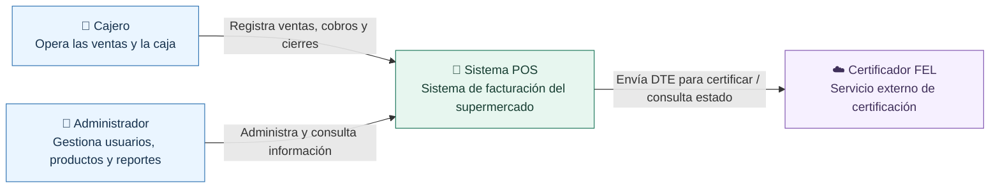

# 🧾 POS Supermercado — Sistema de facturación electrónica FEL

**Sistema de punto de venta para supermercado, con control de caja y emisión de documentos FEL en Guatemala.**

> **Estado:** preparación del repositorio (Sprint 0). La documentación y las convenciones de colaboración están listas; la aplicación aún no ha sido inicializada ni desplegada.


[Descripción](#-descripción) · [Arquitectura C4](#-arquitectura-c4) · [Estructura](#-estructura-del-repositorio) · [Organización del equipo](#-flujo-de-trabajo) · [Documentación](#-documentación)

## 📌 Descripción

Proyecto académico desarrollado de forma incremental mediante **Scrum adaptado** y sprints. La solución apunta a una tienda con **una sucursal** y un servidor local en LAN. Las cajas utilizan un navegador web; el servidor gestiona las ventas y los datos localmente y se conecta por internet con un certificador FEL cuando corresponde.

**Principales áreas de negocio de la V1:** usuarios y permisos, catálogo, IVA, clientes, ventas, pagos con tarjeta registrados en el POS, facturación FEL, caja, reportes, bitácora y configuración. La arquitectura recoge **13 épicas y 167 historias de usuario: 115 propuestas para la V1 y 52 para etapas futuras**.

**Fuera del alcance inicial:** integración con inventario externo (EP-02), sucursales múltiples (EP-13), otras historias expresamente marcadas como futuras en el documento arquitectónico.

## 🧩 Arquitectura C4

El sistema sigue un **monolito modular cliente-servidor**. Se presenta en dos niveles C4: contexto y contenedores. Se emplea Mermaid compatible con Markdown de GitHub, con los elementos y relaciones propios del modelo C4.

### Nivel 1 · Diagrama de contexto



### Nivel 2 · Diagrama de contenedores

```mermaid
flowchart LR
    subgraph LAN["Supermercado · Red local (LAN)"]
        Cajero["👤 Cajero / Administrador"]
        subgraph Clientes["Equipos de caja y administración"]
            Web["🌐 Aplicación web SPA<br/>React 19 + TypeScript + Vite"]
        end
        subgraph Servidor["Servidor local"]
            API["☕ API y procesos<br/>Java 21 + Spring Boot 4.1<br/>Monolito modular"]
            BD[("🗃️ PostgreSQL 16<br/>Persistencia local")]
        end
        Imp["🖨️ Impresora térmica<br/>Red / ESC-POS (previsto)"]
    end
    FEL["☁️ Certificador FEL<br/>API externa"]
    Cajero -->|Utiliza| Web
    Web -->|HTTP(S) / JSON| API
    API -->|SQL| BD
    API -->|TCP 9100, si es de red| Imp
    API -->|HTTPS / DTE| FEL
    classDef app fill:#eaf5ff,stroke:#3275b3,color:#17324d;
    classDef server fill:#e7f6ef,stroke:#21795d,color:#173e32;
    classDef outside fill:#f6f0ff,stroke:#8156b0,color:#40305b;
    class Cajero,Web app;
    class API,BD,Imp server;
    class FEL outside;
```

> **Aclaración:** el terminal bancario no está integrado directamente al software en la V1; se registra la información permitida de la transacción. El modo contingencia FEL está previsto para interrupciones de internet. El soporte para impresoras USB es una decisión pendiente.

Para una notación C4 específica de Mermaid y el mapa de módulos, consultar [diagramas de arquitectura](docs/arquitectura/README.md). El diseño detallado está en [Architecture.md](docs/original/Architecture.md).

## 🛠️ Stack tecnológico previsto

| Capa | Tecnología | Propósito |
|---|---|---|
| Frontend | React 19, TypeScript, Vite | Interfaz web para caja y administración |
| Backend | Java 21, Spring Boot 4.1 | API REST, lógica de negocio y tareas programadas |
| Base de datos | PostgreSQL 16 | Persistencia de ventas, caja, clientes y facturas |
| Migraciones | Flyway | Versionado del esquema SQL |
| Desarrollo | Docker Compose | Base de datos reproducible por integrante |
| Pruebas (futuras) | JUnit, Testcontainers, Playwright | Pruebas backend, integración y E2E |

## 🗂️ Estructura del repositorio

```text
pos-supermercado/
├── .github/
│   ├── ISSUE_TEMPLATE/       # Plantillas para HU, bugs y tareas técnicas
│   ├── workflows/            # Verificación inicial del repositorio
│   └── pull_request_template.md
├── backend/                  # Se inicializará en el Hello World arquitectónico
├── frontend/                 # Se inicializará en el Hello World arquitectónico
├── docs/
│   ├── arquitectura/         # C4 y diagramas complementarios
│   ├── proceso/              # Convenciones del equipo y Definition of Done
│   └── original/             # Requisitos y arquitectura recibidos (sin modificar)
├── .editorconfig
├── .gitattributes
├── .gitignore
├── CONTRIBUTING.md
└── README.md
```

La estructura de paquetes Java y módulos React se definirá al inicializar las aplicaciones, siguiendo [la propuesta original](docs/original/Architecture.md).

## 🌿 Flujo de trabajo

Se usa una **variante liviana de GitFlow** adecuada para el curso:

- `main`: entregas verificadas y estables.
- `develop`: integración del trabajo del sprint actual.
- `feature/HU-XX.XX-descripcion`: implementación de una historia de usuario.
- `fix/descripcion`: corrección de errores.
- `docs/descripcion`: documentación y diagramas.
- `chore/descripcion`: configuración y mantenimiento.

**Rama de trabajo → Pull Request a `develop` → revisión + CI → merge.** Para cada entrega del curso: **Pull Request de `develop` a `main`** y etiqueta de versión (`v0.1.0`, etc., si el equipo decide usarlas).

Los criterios de aceptación se documentan en las historias. No se debe hacer push directo a `main` ni a `develop` cuando el repositorio permita aplicar sus protecciones. Leer [CONTRIBUTING.md](CONTRIBUTING.md) y [guía del repositorio](docs/proceso/repositorio-github.md).

## 🏃 Organización ágil

El backlog original incluye 13 épicas; el plan arquitectónico propone **Sprint 0 de preparación** y **sprints 1–8** como punto de partida, sujeto a la capacidad y calendario real del equipo. Las tareas se administrarán como **GitHub Issues** y se agruparán en **GitHub Projects** cuando se defina el compromiso de cada sprint.

- [Épicas](docs/original/epics.md)
- [Historias de usuario por épica](docs/original/)
- [Planificación y DoD](docs/proceso/scrum.md)

## 🚀 Cómo ejecutar el proyecto

**Pendiente del Hello World arquitectónico.** En Sprint 0 se prepararán `backend/`, `frontend/`, la base de datos para desarrollo y las instrucciones comprobadas de instalación. No se documentan comandos de ejecución hasta que sean funcionales y probados.

## 📚 Documentación

| Documento | Contenido |
|---|---|
| [Arquitectura original](docs/original/Architecture.md) | Diseño, módulos, datos, seguridad, flujos y sprints propuestos |
| [Épicas originales](docs/original/epics.md) | Alcance funcional |
| [Historias de usuario](docs/original/) | Un archivo por épica |
| [Diagramas C4](docs/arquitectura/README.md) | Contexto, contenedores y módulos |
| [Colaboración](CONTRIBUTING.md) | Ramas, commits, PRs y revisiones |
| [Guía GitHub](docs/proceso/repositorio-github.md) | Configuración de branches y opciones del repositorio |
| [Scrum adaptado](docs/proceso/scrum.md) | Sprint 0, ceremonias mínimas y Definition of Done |

> **Nota de trazabilidad:** `Architecture.md` hace referencia a `Documentacion_POS_Supermercado.pdf`; ese archivo no estaba incluido en el material proporcionado para preparar este repositorio.

---

**Proyecto académico · Guatemala · Entrega inicial / Sprint 0**
