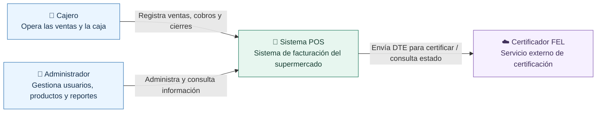

# 🧾 POS Supermercado — Sistema de facturación electrónica FEL

**Sistema de punto de venta para supermercado, con control de caja y emisión de documentos FEL en Guatemala.**

> **Estado:** Sprint 0 — scaffold de frontend, backend y PostgreSQL preparado para verificación local. Aún no incluye ventas ni certificación FEL real.


[Descripción](#-descripción) · [Arquitectura C4](#-arquitectura-c4) · [Roadmap](#-roadmap-de-sprints) · [Estructura](#-estructura-del-repositorio) · [Organización del equipo](#-flujo-de-trabajo) · [Documentación](#-documentación)

## 📌 Descripción

Proyecto académico desarrollado de forma incremental mediante **Scrum adaptado** y sprints. La solución apunta a una tienda con **una sucursal** y un servidor local en LAN. Las cajas utilizan un navegador web; el servidor gestiona las ventas y los datos localmente y se conecta por internet con un certificador FEL cuando corresponde.

**Principales áreas de negocio de la V1:** usuarios y permisos, catálogo, IVA, clientes, ventas, pagos con tarjeta registrados en el POS, facturación FEL, caja, reportes, bitácora y configuración. La arquitectura recoge **13 épicas y 167 historias de usuario: 115 propuestas para la V1 y 52 para etapas futuras**.

**Fuera del alcance inicial:** integración con inventario externo (EP-02), sucursales múltiples (EP-13), otras historias expresamente marcadas como futuras en el documento arquitectónico.

## 🧩 Arquitectura C4

El sistema sigue un **monolito modular cliente-servidor**. Se presenta en dos niveles C4: contexto y contenedores. Se emplea Mermaid compatible con Markdown de GitHub, con los elementos y relaciones propios del modelo C4.

### Nivel 1 · Diagrama de contexto



### Nivel 2 · Diagrama de contenedores

```mermaid
flowchart LR
    subgraph LAN["Supermercado · Red local (LAN)"]
        Cajero["👤 Cajero / Administrador"]
        subgraph Clientes["Equipos de caja y administración"]
            Web["🌐 Aplicación web SPA<br/>React 19 + TypeScript + Vite"]
        end
        subgraph Servidor["Servidor local"]
            API["☕ API y procesos<br/>Java 21 + Spring Boot 4.1<br/>Monolito modular"]
            BD[("🗃️ PostgreSQL 16<br/>Persistencia local")]
        end
        Imp["🖨️ Impresora térmica<br/>Red / ESC-POS (previsto)"]
    end
    FEL["☁️ Certificador FEL<br/>API externa"]
    Cajero -->|Utiliza| Web
    Web -->|HTTP(S) / JSON| API
    API -->|SQL| BD
    API -->|TCP 9100, si es de red| Imp
    API -->|HTTPS / DTE| FEL
    classDef app fill:#eaf5ff,stroke:#3275b3,color:#17324d;
    classDef server fill:#e7f6ef,stroke:#21795d,color:#173e32;
    classDef outside fill:#f6f0ff,stroke:#8156b0,color:#40305b;
    class Cajero,Web app;
    class API,BD,Imp server;
    class FEL outside;
```

> **Aclaración:** el terminal bancario no está integrado directamente al software en la V1; se registra la información permitida de la transacción. El modo contingencia FEL está previsto para interrupciones de internet. El soporte para impresoras USB es una decisión pendiente.

Para una notación C4 específica de Mermaid y el mapa de módulos, consultar [diagramas de arquitectura](docs/arquitectura/README.md). El diseño detallado está en [Architecture.md](docs/original/Architecture.md).

## 🛠️ Stack tecnológico previsto

| Capa | Tecnología | Propósito |
|---|---|---|
| Frontend | React 19, TypeScript, Vite | Interfaz web para caja y administración |
| Backend | Java 21, Spring Boot 4.1 | API REST, lógica de negocio y tareas programadas |
| Base de datos | PostgreSQL 16 | Persistencia de ventas, caja, clientes y facturas |
| Migraciones | Flyway | Versionado del esquema SQL |
| Desarrollo | Docker Compose | Base de datos reproducible por integrante |
| Pruebas (futuras) | JUnit, Testcontainers, Playwright | Pruebas backend, integración y E2E |

## 🗂️ Estructura del repositorio

```text
pos-supermercado/
├── .github/
│   ├── ISSUE_TEMPLATE/       # Plantillas para HU, bugs y tareas técnicas
│   ├── workflows/            # Verificación inicial del repositorio
│   └── pull_request_template.md
├── backend/                  # Spring Boot, módulos y Flyway
├── frontend/                 # React, TypeScript y Vite
├── docs/
│   ├── arquitectura/         # C4 y diagramas complementarios
│   ├── proceso/              # Convenciones del equipo y Definition of Done
│   └── original/             # Requisitos y arquitectura recibidos (sin modificar)
├── docker/                   # Inicialización de roles PostgreSQL
├── docker-compose.yml       # PostgreSQL para desarrollo
├── scripts/                  # Arranque cruzado con npm y Maven Wrapper
├── package.json             # Comandos unificados desde la raíz
├── .env.example             # Variables de ejemplo, nunca credenciales reales
├── .editorconfig
├── .gitattributes
├── .gitignore
├── CONTRIBUTING.md
└── README.md
```

Los módulos Java y React ya tienen estructura inicial de Sprint 0, siguiendo [la propuesta original](docs/original/Architecture.md).

## 🌿 Flujo de trabajo

Se usa una **variante liviana de GitFlow** adecuada para el curso:

- `main`: entregas verificadas y estables.
- `develop`: integración del trabajo del sprint actual.
- `feature/HU-XX.XX-descripcion`: implementación de una historia de usuario.
- `fix/descripcion`: corrección de errores.
- `docs/descripcion`: documentación y diagramas.
- `chore/descripcion`: configuración y mantenimiento.

**Rama de trabajo → Pull Request a `develop` → revisión + CI → merge.** Para cada entrega del curso: **Pull Request de `develop` a `main`** y etiqueta de versión (`v0.1.0`, etc., si el equipo decide usarlas).

Los criterios de aceptación se documentan en las historias. No se debe hacer push directo a `main` ni a `develop` cuando el repositorio permita aplicar sus protecciones. Leer [CONTRIBUTING.md](CONTRIBUTING.md) y [guía del repositorio](docs/proceso/repositorio-github.md).

## 🏃 Organización ágil

El backlog original incluye **13 épicas y 167 historias de usuario**, de las cuales **115 HU** integran el alcance propuesto para la V1 (las otras 52 quedan para futuras etapas). El **Sprint 0** prepara el entorno y los **sprints 1–8** distribuyen las 115 HU. La distribución es una **meta orientativa**, no un compromiso cerrado ni un calendario de 25 semanas: se ajustará a la capacidad real del equipo de tres integrantes y a las fechas del curso.

### 🗺️ Roadmap de sprints

El esquema se lee **de arriba hacia abajo por etapas** y **de izquierda a derecha dentro de cada etapa**. Los colores distinguen la prioridad de las historias.

```mermaid
flowchart TB
    subgraph BASE["Etapa 1 · Fundamentos"]
        direction LR
        S0["Sprint 0<br/>Preparación del entorno<br/>Base · sin HU"] --> S1["Sprint 1<br/>Acceso, usuarios y bitácora<br/>15 HU · Alta"] --> S2["Sprint 2<br/>Catálogo, IVA y apertura de caja<br/>17 HU · Alta"]
    end

    subgraph NUCLEO["Etapa 2 · Flujo de venta y facturación"]
        direction LR
        S3["Sprint 3<br/>Pantalla de venta y clientes<br/>18 HU · Alta"] --> S4["Sprint 4<br/>Cobro y emisión FEL<br/>17 HU · Alta"] --> S5["Sprint 5<br/>Contingencia, anulación y cierre<br/>10 HU · Alta"]
    end

    subgraph MEJORAS["Etapa 3 · Reportes y operación"]
        direction LR
        S6["Sprint 6<br/>Reportes y exportación<br/>10 HU · Alta"] --> S7["Sprint 7<br/>Operación: suspendidas, cierres y correos<br/>14 HU · Media"] --> S8["Sprint 8<br/>Consultas, precios, bitácora y panel<br/>14 HU · Media/Baja"]
    end

    classDef base fill:#eaf5ff,stroke:#3275b3,color:#17324d;
    classDef alta fill:#fff0e0,stroke:#c47420,color:#5a330c;
    classDef media fill:#e7f6ef,stroke:#21795d,color:#173e32;
    class S0 base;
    class S1,S2,S3,S4,S5,S6 alta;
    class S7,S8 media;
```



**Hitos previstos:** al cerrar el **Sprint 5**, contar con un flujo mínimo de venta, cobro, FEL, contingencia y cierre de caja; al completar el **Sprint 8**, cubrir las **115 HU** planificadas para la V1. Estos hitos describen objetivos, no funcionalidades ya implementadas.

Las historias se administrarán como **GitHub Issues** y se agruparán en **GitHub Projects**, reajustando el compromiso de cada sprint según avance, prioridades y dependencias.

- [Épicas](docs/original/epics.md)
- [Historias de usuario por épica](docs/original/)
- [Planificación y DoD](docs/proceso/scrum.md)

## 🚀 Cómo ejecutar el proyecto (Sprint 0)

**Requisitos:** Node.js 24, Java 21 y Docker Desktop abierto. Ejecutar desde la **raíz** del repositorio:

```powershell
npm install
npm run dev
```

`npm install` crea el `.env` local a partir de `.env.example` (si no existe) e instala las dependencias del frontend; `npm run dev` arranca PostgreSQL con Docker Compose y luego ejecuta Spring Boot y Vite. **No es necesario instalar Maven globalmente**: el backend utiliza Maven Wrapper.

- **Frontend:** http://localhost:5173/sistema
- **Backend:** http://localhost:8080/api/sistema/info
- **Health:** http://localhost:8080/actuator/health

```powershell
npm run build     # frontend + backend
npm run test      # Vitest + JUnit/Testcontainers (Docker requerido)
npm run lint      # frontend
npm run db:down   # detener PostgreSQL sin eliminar datos
```

Para diagnóstico, configuración avanzada y otros comandos: [guía de entorno](docs/proceso/entorno-desarrollo.md). **El simulador FEL es solo para desarrollo**, no emite documentos tributarios reales.

## 📚 Documentación

| Documento | Contenido |
|---|---|
| [Arquitectura original](docs/original/Architecture.md) | Diseño, módulos, datos, seguridad, flujos y sprints propuestos |
| [Épicas originales](docs/original/epics.md) | Alcance funcional |
| [Historias de usuario](docs/original/) | Un archivo por épica |
| [Diagramas C4](docs/arquitectura/README.md) | Contexto, contenedores y módulos |
| [Colaboración](CONTRIBUTING.md) | Ramas, commits, PRs y revisiones |
| [Guía GitHub](docs/proceso/repositorio-github.md) | Configuración de branches y opciones del repositorio |
| [Entorno de desarrollo](docs/proceso/entorno-desarrollo.md) | Instalación, scripts npm, Maven y PostgreSQL |
| [Scrum adaptado](docs/proceso/scrum.md) | Sprint 0, ceremonias mínimas y Definition of Done |

> **Nota de trazabilidad:** `Architecture.md` hace referencia a `Documentacion_POS_Supermercado.pdf`; ese archivo no estaba incluido en el material proporcionado para preparar este repositorio.

---

**Proyecto académico · Guatemala · Entrega inicial / Sprint 0**
