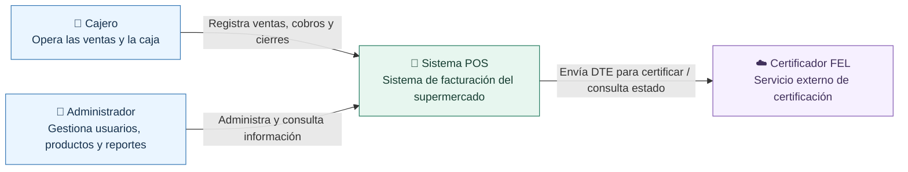
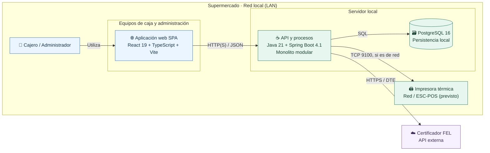

# 🧾 POS Supermercado — Sistema de facturación electrónica FEL

**Sistema de punto de venta para supermercado, con control de caja y emisión de documentos FEL en Guatemala.**

> **Estado:** producto mínimo con reportes (`v0.7.0`) — vende, cobra con tarjeta, factura con FEL (con contingencia, rechazos, anulación y reimpresión), cierra la caja con su comprobante y ofrece los reportes de ventas, cajeros, tarjetas, IVA, cierres y anuladas, exportables a PDF y Excel. La certificación se prueba con un certificador simulado (el certificador real aún no se elige). Faltan las historias de prioridad media y baja (Sprints 7 y 8).


[Descripción](#-descripción) · [Funcionalidades](#-funcionalidades-disponibles) · [Arquitectura C4](#-arquitectura-c4) · [Roadmap](#-roadmap-de-sprints) · [Estructura](#-estructura-del-repositorio) · [Organización del equipo](#-flujo-de-trabajo) · [Documentación](#-documentación)

## 📌 Descripción

Proyecto académico desarrollado de forma incremental mediante **Scrum adaptado** y sprints. La solución apunta a una tienda con **una sucursal** y un servidor local en LAN. Las cajas utilizan un navegador web; el servidor gestiona las ventas y los datos localmente y se conecta por internet con un certificador FEL cuando corresponde.

**Principales áreas de negocio de la V1:** usuarios y permisos, catálogo, IVA, clientes, ventas, pagos con tarjeta registrados en el POS, facturación FEL, caja, reportes, bitácora y configuración. La arquitectura recoge **13 épicas y 167 historias de usuario: 115 propuestas para la V1 y 52 para etapas futuras**.

**Fuera del alcance inicial:** integración con inventario externo (EP-02), sucursales múltiples (EP-13), otras historias expresamente marcadas como futuras en el documento arquitectónico.

## ✅ Funcionalidades disponibles

| Área | Qué se puede hacer | Historias | Versión |
|---|---|---|---|
| Acceso | Iniciar sesión con contraseña (Administrador, Supervisor) o con PIN (Cajero); cerrar sesión (no con una venta en curso); cambiar la contraseña o el PIN propio | HU-01.01, 01.02, 01.13, 01.16 | `v0.2.0` |
| Usuarios | Crear, consultar con búsqueda y filtros, editar, asignar rol, activar y desactivar; el Administrador restablece contraseñas y PIN (cierra las sesiones abiertas del usuario) | HU-01.05 a 01.09, 01.14 | `v0.2.0` |
| Permisos | Matriz de permisos por rol; cada endpoint exige su permiso en el servidor y los accesos denegados quedan registrados | HU-01.11 | `v0.2.0` |
| Configuración | Registrar cajas con su serie de facturación y vincular el equipo (navegador) de cada caja | HU-12.05 | `v0.2.0` |
| Bitácora | Registro automático de las acciones sensibles, con usuario, rol, caja y valores anteriores y nuevos; inmutable, encadenada con hashes y con verificación de integridad | HU-11.01, 11.02, 11.05 | `v0.2.0` |
| Bitácora | Los intentos sin permiso registran el permiso que faltaba y la caja; las acciones automáticas quedan a nombre del usuario técnico "sistema" | HU-11.04 | `v0.6.0` |
| Catálogo | Registrar, editar (el código no cambia), activar y desactivar productos; lista con búsqueda, filtros y paginación; buscar por código o por descripción (sin tildes ni mayúsculas); códigos no encontrados para registrar después | HU-03.01 a 03.04, 03.06 a 03.09 | `v0.3.0` |
| IVA | IVA del 12 % incluido en el precio; base e IVA con 6 decimales por línea y redondeo HALF_UP solo en los totales ([reglas](docs/arquitectura/calculo-iva.md)) | HU-04.01 a 04.05 | `v0.3.0` |
| Caja | Abrir el turno en la caja del equipo (uno por caja y por cajero); sin turno abierto no se vende | HU-09.01 a 09.03 | `v0.3.0` |
| Cierre de caja | Resumen por tarjeta (sin las anuladas), total del cierre de lote, diferencia con justificación obligatoria, turno cerrado inmodificable, comprobante con firmas y reimpresión de cierres anteriores | HU-09.08 a 09.10 | `v0.6.0` |
| Venta | Pantalla de venta con número interno; agregar con lector, código escrito o búsqueda por descripción (F2); el precio de cada línea se mantiene aunque cambie en el catálogo; totales y desglose de IVA calculados por el servidor; cancelar con confirmación | HU-06.01 a 06.03, 06.09, 06.14 | `v0.3.0` (adelanto del Sprint 3) |
| Venta | Totales siempre visibles; cantidad con `6*` antes del código o editando la línea, con confirmación por encima del límite configurado; quitar líneas (quedan en la bitácora, sin borrarse); dejar ventas en espera y retomarlas; atajos de teclado con ayuda (F1); pasar al cobro con el total (el registro del pago con tarjeta llega con EP-07) | HU-06.04, 06.07, 06.08, 06.12, 06.13, 06.15, 06.17 | `v0.4.0` |
| Cobro | Cobrar con tarjeta (tipo, autorización y últimos 4, nunca el número completo); quitar un pago antes de finalizar; finalizar solo con el pago completo, en una transacción, y la caja queda lista para la siguiente venta | HU-07.03, 07.06, 07.07, 07.08 | `v0.5.0` |
| Clientes | Cliente de la venta por NIT (con o sin guion, F6): se cargan sus datos o se consulta el nombre al certificador; registro sin duplicados; NIT validado con el módulo 11 de la SAT; volver a Consumidor Final con un clic | HU-05.01 a 05.05 | `v0.5.0` |
| Facturación FEL | Documento de la factura (DTE tipo FACT, esquema FEL de la SAT) con los montos que guardó el POS; certificación al finalizar con tiempo límite (sin respuesta, queda en contingencia); identificador único por venta y consulta antes de reenviar, para no duplicar facturas | HU-08.01 a 08.04, 04.09 (parcial) | `v0.5.0` |
| Rechazos FEL | Motivo del rechazo en lenguaje comprensible; el cajero corrige el cliente y reenvía sin volver a cobrar; los demás quedan en "Facturas rechazadas" para el supervisor | HU-08.06, 04.09 | `v0.6.0` |
| Contingencia | Sin conexión con el certificador se emite el comprobante con número de acceso y se avisa en la venta; un proceso automático lo certifica después, en orden y con espera creciente; aviso al supervisor desde el día 12 de los 15 que da la SAT | HU-08.07 a 08.09 | `v0.6.0` |
| Anulación y reimpresión | El supervisor anula una factura con motivo mientras el turno de la venta siga abierto; reimprimir la última factura con F9 o buscar facturas anteriores, con la leyenda de copia | HU-08.10, 08.12, 09.02 | `v0.6.0` |
| Impresión | Factura impresa en la impresora térmica de red de la caja (ESC/POS, 58 u 80 mm) con emisor, receptor, autorización, detalle, Subtotal, IVA y TOTAL, pago y certificador; si la impresora falla, la factura sigue válida | HU-08.05 | `v0.5.0` |
| Configuración | Datos del emisor y del establecimiento SAT; conexión con el certificador (https, llave cifrada con AES-256-GCM, ambiente de pruebas o producción); impresoras por caja con página de prueba y copias | HU-12.01, 12.02, 12.03, 12.08, 12.15 | `v0.5.0` |
| Reportes | Filtros comunes (fechas obligatorias, caja, cajero, tipo de tarjeta) con rangos rápidos según la fecha del servidor; ventas por período (por día, semana o mes), por cajero con el detalle de sus ventas, ingresos por tipo de tarjeta con sus transacciones, IVA de las facturas certificadas por día y por factura, cierres de caja con faltantes y sobrantes, y facturas anuladas; las anuladas no se suman a las ventas | HU-10.01 a 10.03, 10.06 a 10.09 | `v0.7.0` |
| Exportación | Cada reporte y detalle se exporta a PDF (con los datos de la empresa, los filtros, la fecha y el usuario) y a Excel (montos como números y fechas como fechas), con los mismos totales que la pantalla | HU-10.13, 10.14 | `v0.7.0` |
| Acceso a reportes | Solo el Administrador y el Supervisor (permiso de consultar reportes); cada generación y exportación queda en la bitácora | HU-10.15 | `v0.7.0` |

Las reglas que dependen de módulos futuros (clientes, cobro, facturación, cierre de caja) quedan anotadas en sus Issues y se completan en su sprint.

## 🧩 Arquitectura C4

El sistema sigue un **monolito modular cliente-servidor**. Se presenta en dos niveles C4: contexto y contenedores. Se emplea Mermaid compatible con Markdown de GitHub, con los elementos y relaciones propios del modelo C4.

### Nivel 1 · Diagrama de contexto



### Nivel 2 · Diagrama de contenedores



> **Aclaración:** el terminal bancario no está integrado directamente al software en la V1; se registra la información permitida de la transacción. El modo contingencia FEL está previsto para interrupciones de internet. El soporte para impresoras USB es una decisión pendiente.

Para una notación C4 específica de Mermaid y el mapa de módulos, consultar [diagramas de arquitectura](docs/arquitectura/README.md). El diseño detallado está en [Architecture.md](docs/original/Architecture.md).

## 🛠️ Stack tecnológico previsto

| Capa | Tecnología | Propósito |
|---|---|---|
| Frontend | React 19, TypeScript, Vite | Interfaz web para caja y administración |
| Backend | Java 21, Spring Boot 4.1 | API REST, lógica de negocio y tareas programadas |
| Exportación | OpenPDF, Apache POI | Reportes en PDF y en Excel (.xlsx) |
| Base de datos | PostgreSQL 16 | Persistencia de ventas, caja, clientes y facturas |
| Migraciones | Flyway | Versionado del esquema SQL |
| Desarrollo | Docker Compose | Base de datos reproducible por integrante |
| Pruebas | JUnit 5, Testcontainers, ArchUnit, Vitest | Pruebas unitarias, de integración contra PostgreSQL real y reglas de arquitectura |
| Pruebas E2E (futuras) | Playwright | Flujos completos en el navegador |

## 🗂️ Estructura del repositorio

```text
pos-supermercado/
├── .github/
│   ├── ISSUE_TEMPLATE/       # Plantillas para HU, bugs y tareas técnicas
│   ├── workflows/            # Verificación inicial del repositorio
│   └── pull_request_template.md
├── backend/                  # Spring Boot, módulos y Flyway
├── frontend/                 # React, TypeScript y Vite
├── docs/
│   ├── arquitectura/         # C4 y diagramas complementarios
│   ├── proceso/              # Convenciones del equipo y Definition of Done
│   └── original/             # Requisitos y arquitectura recibidos (sin modificar)
├── docker/                   # Inicialización de roles PostgreSQL
├── docker-compose.yml       # PostgreSQL para desarrollo
├── scripts/                  # Arranque cruzado con npm y Maven Wrapper
├── package.json             # Comandos unificados desde la raíz
├── .env.example             # Variables de ejemplo, nunca credenciales reales
├── .editorconfig
├── .gitattributes
├── .gitignore
├── CONTRIBUTING.md
└── README.md
```

Los módulos Java (`seguridad`, `configuracion`, `bitacora`, `catalogo`, `impuestos`, `caja` y `ventas`; los demás, aún vacíos) y React siguen [la propuesta original](docs/original/Architecture.md); las reglas de dependencias entre módulos se verifican con ArchUnit.

## 🌿 Flujo de trabajo

Se usa una **variante liviana de GitFlow** adecuada para el curso:

- `main`: entregas verificadas y estables.
- `develop`: integración del trabajo del sprint actual.
- `feature/HU-XX.XX-descripcion`: implementación de una historia de usuario.
- `fix/descripcion`: corrección de errores.
- `docs/descripcion`: documentación y diagramas.
- `chore/descripcion`: configuración y mantenimiento.

**Rama de trabajo → Pull Request a `develop` → revisión + CI → merge.** Para cada entrega del curso: **Pull Request de `develop` a `main`** y etiqueta de versión (`v0.1.0`, etc., si el equipo decide usarlas).

Los criterios de aceptación se documentan en las historias. No se debe hacer push directo a `main` ni a `develop` cuando el repositorio permita aplicar sus protecciones. Leer [CONTRIBUTING.md](CONTRIBUTING.md) y [guía del repositorio](docs/proceso/repositorio-github.md).

## 🏃 Organización ágil

El backlog original incluye **13 épicas y 167 historias de usuario**, de las cuales **115 HU** integran el alcance propuesto para la V1 (las otras 52 quedan para futuras etapas). El **Sprint 0** prepara el entorno y los **sprints 1–8** distribuyen las 115 HU. La distribución es una **meta orientativa**, no un compromiso cerrado ni un calendario de 25 semanas: se ajustará a la capacidad real del equipo de tres integrantes y a las fechas del curso.

### 🗺️ Roadmap de sprints

El esquema se lee **de arriba hacia abajo por etapas** y **de izquierda a derecha dentro de cada etapa**. Los colores distinguen la prioridad de las historias.

```mermaid
flowchart TB
    subgraph BASE["Etapa 1 · Fundamentos"]
        direction LR
        S0["Sprint 0<br/>Preparación del entorno<br/>Base · sin HU"] --> S1["✅ Sprint 1 · v0.2.0<br/>Acceso, usuarios y bitácora<br/>15 HU · Alta"] --> S2["✅ Sprint 2 · v0.3.0<br/>Catálogo, IVA y apertura de caja<br/>17 HU · Alta"]
    end

    subgraph NUCLEO["Etapa 2 · Flujo de venta y facturación"]
        direction LR
        S3["🔄 Sprint 3 · v0.4.0<br/>Pantalla de venta ✅ y clientes<br/>18 HU · Alta"] --> S4["✅ Sprint 4 · v0.5.0<br/>Cobro y emisión FEL<br/>17 HU · Alta"] --> S5["✅ Sprint 5 · v0.6.0<br/>Contingencia, anulación y cierre<br/>10 HU · Alta"]
    end

    subgraph MEJORAS["Etapa 3 · Reportes y operación"]
        direction LR
        S6["✅ Sprint 6 · v0.7.0<br/>Reportes y exportación<br/>10 HU · Alta"] --> S7["Sprint 7<br/>Operación: suspendidas, cierres y correos<br/>14 HU · Media"] --> S8["Sprint 8<br/>Consultas, precios, bitácora y panel<br/>14 HU · Media/Baja"]
    end

    classDef base fill:#eaf5ff,stroke:#3275b3,color:#17324d;
    classDef alta fill:#fff0e0,stroke:#c47420,color:#5a330c;
    classDef media fill:#e7f6ef,stroke:#21795d,color:#173e32;
    class S0 base;
    class S1,S2,S3,S4,S5,S6 alta;
    class S7,S8 media;
```



**Hitos previstos:** al cerrar el **Sprint 5**, contar con un flujo mínimo de venta, cobro, FEL, contingencia y cierre de caja; al completar el **Sprint 8**, cubrir las **115 HU** planificadas para la V1. Estos hitos describen objetivos, no funcionalidades ya implementadas.

Las historias se administrarán como **GitHub Issues** y se agruparán en **GitHub Projects**, reajustando el compromiso de cada sprint según avance, prioridades y dependencias.

- [Épicas](docs/original/epics.md)
- [Historias de usuario por épica](docs/original/)
- [Planificación y DoD](docs/proceso/scrum.md)

## 🚀 Cómo ejecutar el proyecto

**Requisitos:** Node.js 24, Java 21 y Docker Desktop abierto. Ejecutar desde la **raíz** del repositorio:

```powershell
npm install
npm run dev
```

`npm install` crea el `.env` local a partir de `.env.example` (si no existe) e instala las dependencias del frontend; `npm run dev` arranca PostgreSQL con Docker Compose y luego ejecuta Spring Boot y Vite. **No es necesario instalar Maven globalmente**: el backend utiliza Maven Wrapper.

- **Aplicación:** http://localhost:5173/login
- **Estado del sistema:** http://localhost:5173/sistema
- **Backend:** http://localhost:8080/api/sistema/info
- **Health:** http://localhost:8080/actuator/health

```powershell
npm run build     # frontend + backend
npm run test      # Vitest + JUnit/Testcontainers (Docker requerido)
npm run lint      # frontend
npm run db:down   # detener PostgreSQL sin eliminar datos
```

**Primer acceso:** si no existe ningún Administrador, el backend crea el usuario `admin` con la contraseña temporal `POS_ADMIN_PASSWORD_INICIAL` del `.env`. Desde ahí se crean los demás usuarios y las cajas.

Para diagnóstico, configuración avanzada y otros comandos: [guía de entorno](docs/proceso/entorno-desarrollo.md). **El simulador FEL es solo para desarrollo**, no emite documentos tributarios reales.

## 📚 Documentación

| Documento | Contenido |
|---|---|
| [Arquitectura original](docs/original/Architecture.md) | Diseño, módulos, datos, seguridad, flujos y sprints propuestos |
| [Épicas originales](docs/original/epics.md) | Alcance funcional |
| [Historias de usuario](docs/original/) | Un archivo por épica |
| [Diagramas C4](docs/arquitectura/README.md) | Contexto, contenedores y módulos |
| [Colaboración](CONTRIBUTING.md) | Ramas, commits, PRs y revisiones |
| [Guía GitHub](docs/proceso/repositorio-github.md) | Configuración de branches y opciones del repositorio |
| [Entorno de desarrollo](docs/proceso/entorno-desarrollo.md) | Instalación, scripts npm, Maven y PostgreSQL |
| [Scrum adaptado](docs/proceso/scrum.md) | Sprint 0, ceremonias mínimas y Definition of Done |

> **Nota de trazabilidad:** `Architecture.md` hace referencia a `Documentacion_POS_Supermercado.pdf`; ese archivo no estaba incluido en el material proporcionado para preparar este repositorio.

---

**Proyecto académico · Guatemala · Reportes y exportación del Sprint 6 (`v0.7.0`)**
