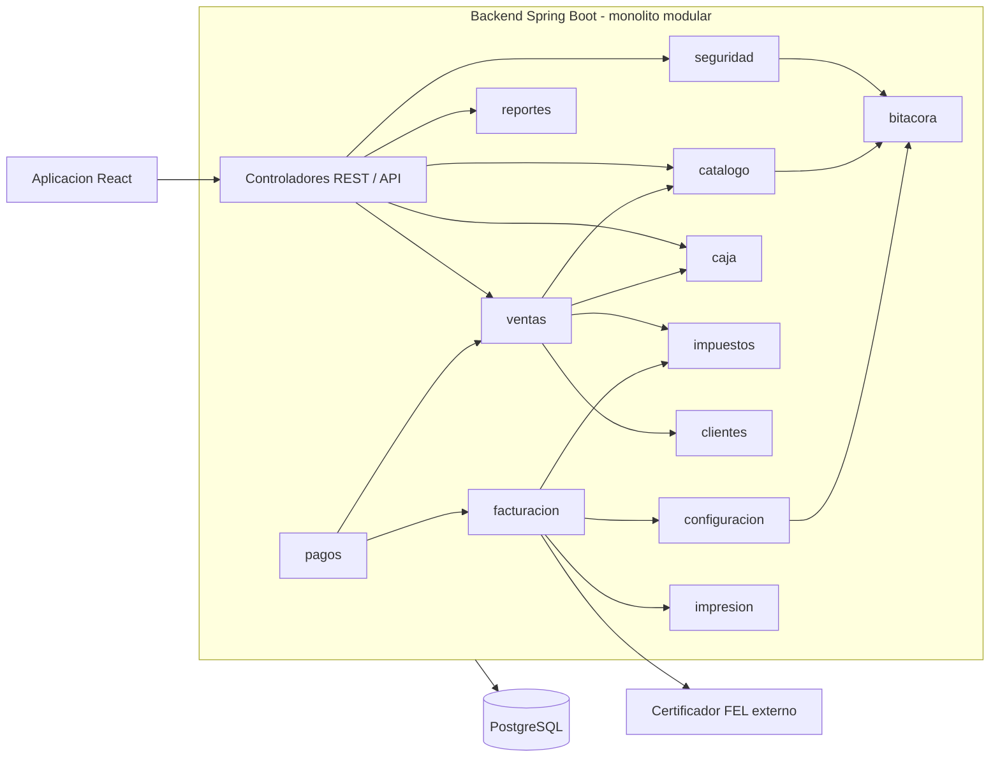

# C4 · Nivel 3: componentes principales del backend

Representación conceptual y simplificada de los componentes/módulos más relevantes del contenedor **API backend** (Spring Boot). Los módulos están propuestos, no implementados todavía.

**Regla de dependencia:** los módulos se comunican mediante servicios de aplicación públicos y no acceden directamente a repositorios internos de otro módulo. Ver la sección 4 del documento arquitectónico original.
