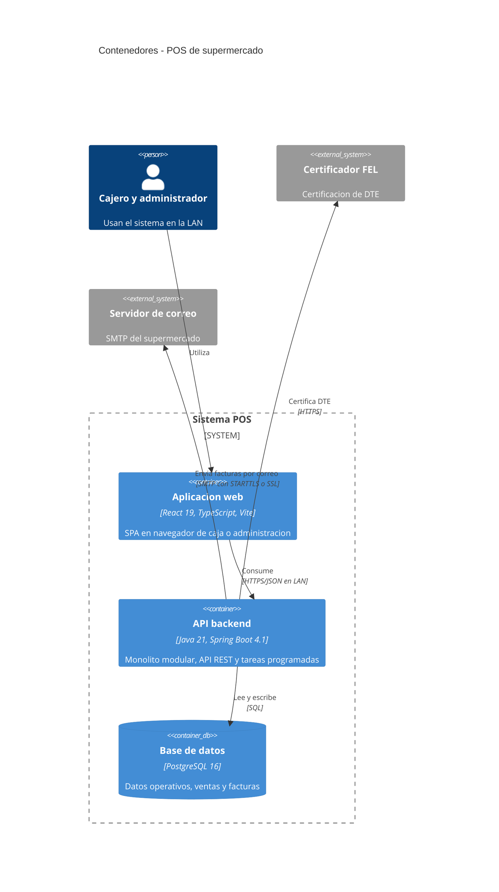

# C4 · Nivel 2: contenedores

**Envío de facturas por correo (HU-08.15):** lo hace el POS, no el certificador (decisión de Sergio, 2026-11-20; cierra el pendiente de `epics.md` y reemplaza lo previsto en `Architecture.md` §6.4). El backend arma el PDF con el mismo contenido del ticket y adjunta el XML del DTE. Usa el servidor SMTP que configura el Administrador en Configuración > Correo, con la contraseña cifrada como la de FEL. Los envíos quedan en `tarea_pendiente` (`ENVIAR_CORREO`) y un proceso programado los reintenta sin afectar la venta.

**Elementos físicos adicionales:** se prevé comunicación backend → impresoras térmicas de red (TCP 9100). La disponibilidad de impresoras USB queda por confirmar. Los lectores de código de barras funcionan como teclado del navegador.
