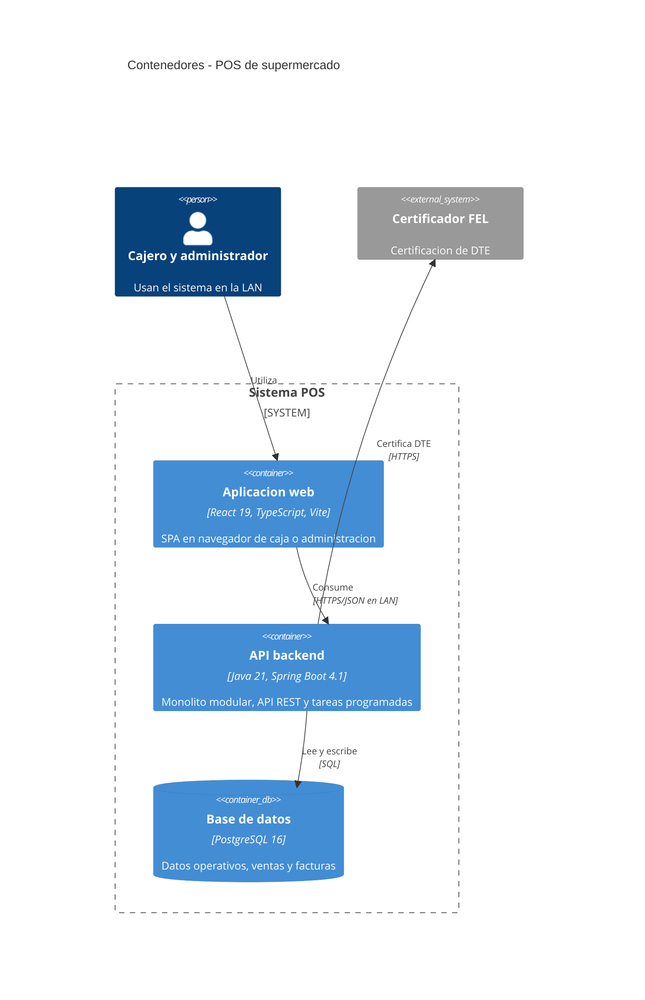

# C4 · Nivel 2: contenedores

**Elementos físicos adicionales:** se prevé comunicación backend → impresoras térmicas de red (TCP 9100). La disponibilidad de impresoras USB queda por confirmar. Los lectores de código de barras funcionan como teclado del navegador.
