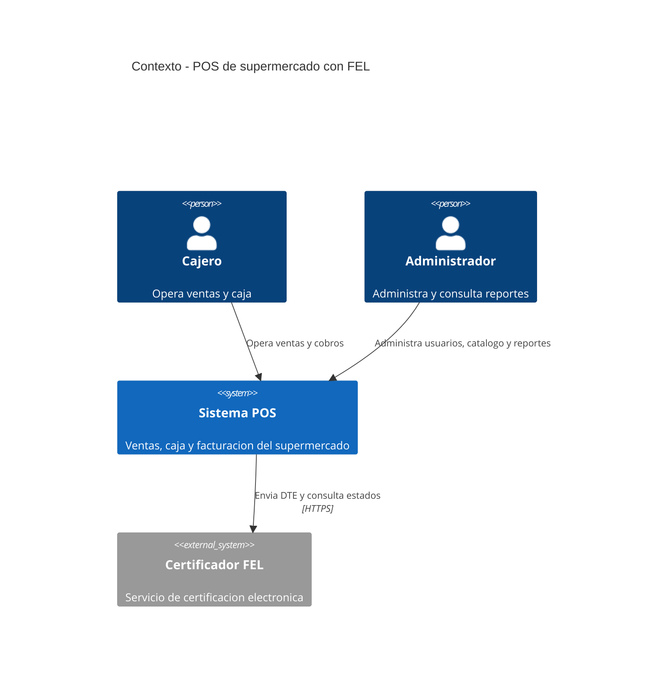

# C4 · Nivel 1: contexto del sistema

**Límite del sistema:** el POS pertenece al supermercado. El certificador es un sistema externo y solo está disponible si hay conexión a internet. No incluye integración directa con un procesador bancario ni con inventario externo en la V1.
