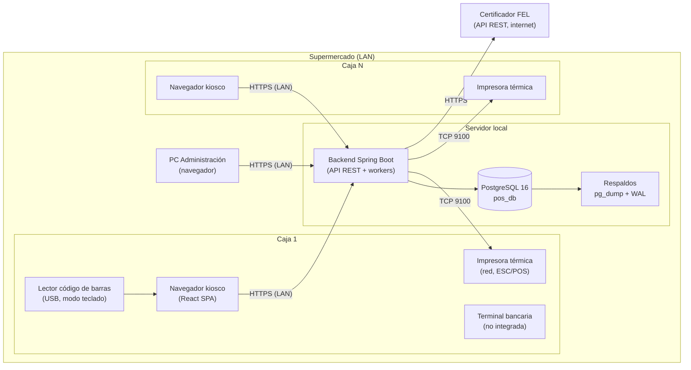
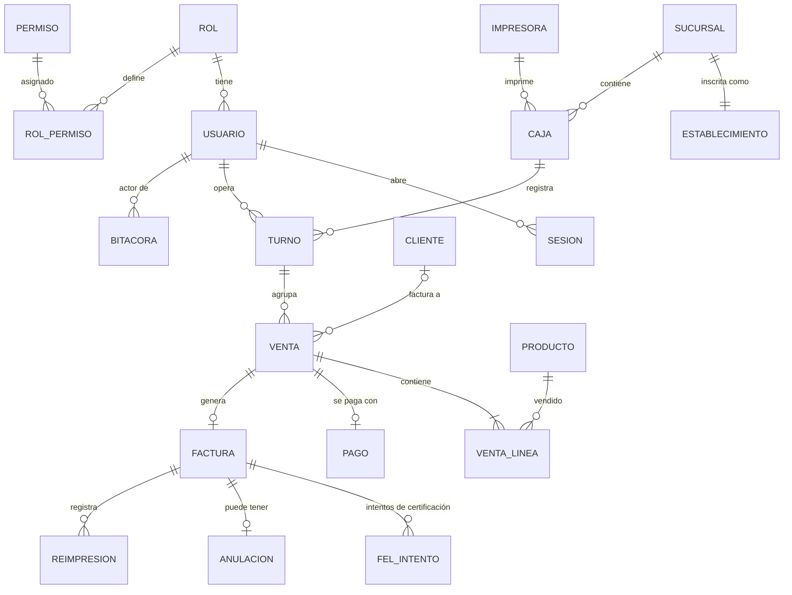
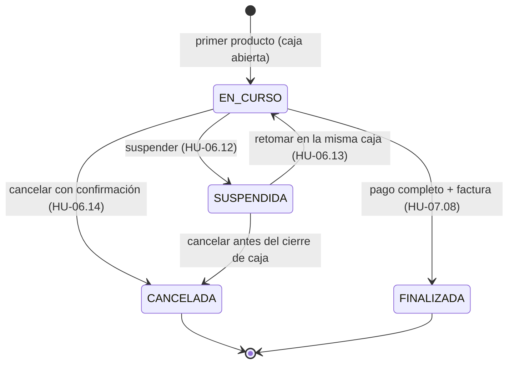
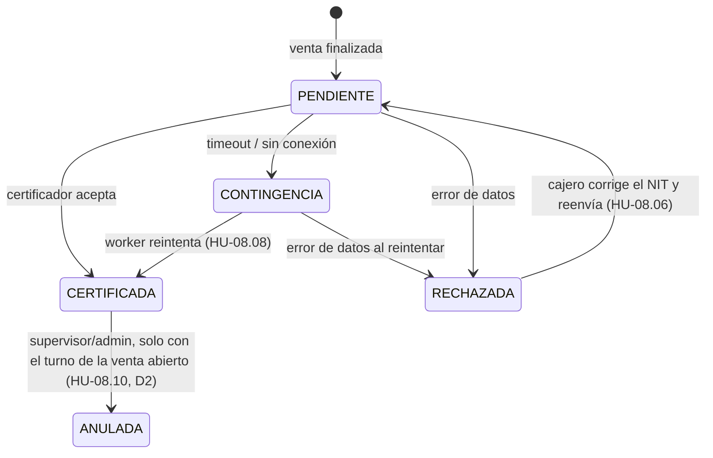

# Arquitectura — Sistema POS con FEL para Supermercado

> Propuesta de arquitectura para la primera versión del POS, basada en las 13 épicas y 167 historias de usuario de esta carpeta (`epics.md`, `userStoriesE1.md` … `userStoriesE13.md`) y en `Documentacion_POS_Supermercado.pdf`. Base de datos: **PostgreSQL local** (instalada en el propio supermercado).

---

## 1. Resumen del análisis

### 1.1 Inventario de épicas e historias

| ID | Épica | Prioridad | Historias | En la V1 | Fuera de la V1 (Futura) |
|----|-------|-----------|:---------:|:--------:|-------------------------|
| EP-01 | Seguridad y usuarios | Alta | 15 | 13 | HU-01.04, HU-01.12 |
| EP-02 | Integración con inventario | Futura | 11 | 0 | Toda la épica |
| EP-03 | Catálogo local de productos | Alta | 12 | 12 | — |
| EP-04 | Cálculo de IVA | Alta | 9 | 6 | HU-04.06, 04.07, 04.08 |
| EP-05 | Gestión de clientes | Alta | 11 | 11 | — |
| EP-06 | Ventas (POS) | Alta | 18 | 12 | HU-06.05, 06.06, 06.10, 06.11, 06.16, 06.18 |
| EP-07 | Pagos | Alta | 10 | 4 | HU-07.01, 07.02, 07.04, 07.05, 07.09, 07.10 |
| EP-08 | Comprobantes y FEL | Alta | 15 | 14 | HU-08.11 |
| EP-09 | Control de caja | Alta | 14 | 10 | HU-09.04, 09.05, 09.07, 09.14 |
| EP-10 | Reportes | Media | 15 | 14 | HU-10.10 |
| EP-11 | Auditoría (bitácora) | Media | 10 | 10 | — |
| EP-12 | Configuración | Alta | 15 | 9 | HU-12.04, 12.06, 12.10, 12.11, 12.12, 12.14 |
| EP-13 | Sucursales | Baja | 12 | 0 | Toda la épica (el cliente confirmó una sola sucursal, "Matriz") |
| | **Total** | | **167** | **115** | **52** |

(HU-01.03 fue eliminada y no se cuenta.)

### 1.2 Reglas de negocio que más condicionan la arquitectura

| Regla | Fuente | Impacto en el diseño |
|-------|--------|----------------------|
| IVA 12 % incluido; líneas con 6 decimales, totales redondeados a 2 (HALF_UP) | EP-04 | Aritmética decimal exacta (`BigDecimal` / `NUMERIC`), nunca `float`. Un único módulo de cálculo con pruebas. |
| Búsqueda por código en < 1 s; búsqueda por descripción sin tildes ni mayúsculas | HU-03.06, 03.07 | Índice único en código de barras; `unaccent` + `pg_trgm` en PostgreSQL. |
| Una venta nunca genera dos facturas; contingencia si el certificador no responde | HU-08.04, 08.07, 08.08 | Identificador idempotente por venta, máquina de estados de la factura y un proceso en segundo plano que reintenta. |
| Contingencia máx. 15 días; anulación dentro del mes de emisión | Pendientes EP-08 | Alertas por antigüedad y validación de plazo al anular. |
| Una caja = un turno abierto; un cajero = un turno abierto | HU-09.03 | Índices únicos parciales en PostgreSQL (la BD lo garantiza, no solo el código). |
| Cierre confirmado inmodificable; bitácora inmodificable y verificable | HU-09.08, HU-11.05 | Triggers que bloquean `UPDATE/DELETE`, permisos de BD restringidos y encadenamiento de hashes. |
| Permisos validados en el servidor | HU-01.11 | Autorización en el backend por permiso, no solo ocultando botones. |
| El precio de una línea no cambia durante la venta; los cambios no alteran facturas emitidas | HU-06.09, 03.02, 05.09 | Las líneas y facturas guardan **copias** (snapshot) de precio, descripción, receptor y emisor. |
| Contraseñas/PIN con hash seguro; credenciales FEL cifradas; nunca el número completo de la tarjeta | EP-01, HU-12.15, EP-07 | Argon2id/bcrypt para credenciales de usuario, AES-GCM para secretos de configuración, solo últimos 4 dígitos. |
| Fecha y hora tomadas del servidor | HU-11.02 | Todos los `timestamp` se generan en PostgreSQL (`now()`), no en la caja. |

---

## 2. Estilo arquitectónico

**Monolito modular cliente-servidor en red local (LAN)**, con:

- **Un servidor local** en el supermercado que ejecuta el backend y PostgreSQL.
- **Cajas como clientes web** (navegador en modo kiosco) que se conectan al servidor por la LAN.
- **Integraciones externas** solo hacia el certificador FEL (por internet).

**Por qué un monolito modular y no microservicios:** es una sola tienda, un equipo pequeño y un solo despliegue. Los módulos se separan por épica dentro de un solo proyecto, con límites claros, para poder extraer piezas más adelante (por ejemplo, la integración con inventario de EP-02 o las sucursales de EP-13) sin reescribir.

**Por qué web en LAN y no aplicación de escritorio:** se instala y actualiza en un solo lugar (el servidor), las cajas solo necesitan un navegador, y los lectores de código de barras funcionan como teclado (HU-03.06), así que no hace falta acceso al hardware para escanear.

### 2.1 Diagrama de despliegue



Si se cae el internet, **todo sigue funcionando** salvo la certificación FEL, que entra en contingencia (HU-08.07). Si se cae el servidor local, las cajas no pueden vender: por eso el servidor necesita UPS y respaldos (sección 9).

---

## 3. Stack tecnológico propuesto

| Capa | Tecnología | Motivo |
|------|-----------|--------|
| Base de datos | **PostgreSQL 16** local, extensiones `pg_trgm`, `unaccent`, `pgcrypto` | Requisito del proyecto; `NUMERIC` exacto, índices parciales, triggers, búsqueda difusa. |
| Migraciones | **Flyway** | Esquema versionado en el repositorio; cada sprint agrega migraciones `V{n}__descripcion.sql`. |
| Backend | **Java 21 + Spring Boot 4.1** (Web MVC, Security, Data JPA, Validation, Flyway, Actuator) | `BigDecimal` con `RoundingMode.HALF_UP` cubre EP-04 de forma nativa; Spring Security para roles/permisos; ecosistema maduro para PDF/Excel. |
| Acceso a datos | Spring Data JPA (CRUD) + **jOOQ o JdbcTemplate** para reportes | JPA para entidades; SQL explícito para reportes agregados (EP-10). |
| Frontend | **React 19 + TypeScript + Vite**, TanStack Query, React Router | SPA rápida para la pantalla de venta orientada a teclado (HU-06.17). |
| Impresión | ESC/POS por TCP 9100 desde el backend (librería `escpos-coutinho`) | Las impresoras térmicas en red se manejan desde el servidor sin instalar nada en las cajas. |
| Exportación | **Apache POI** (Excel .xlsx), **OpenPDF** (PDF) | HU-10.13 y HU-10.14. |
| Hash de credenciales | **Argon2id** (Spring Security `Argon2PasswordEncoder`) | HU-01.02, 01.05. |
| Pruebas | JUnit 5, **Testcontainers (PostgreSQL)**, Playwright (E2E) | Pruebas automáticas del redondeo (HU-04.05) y de la consistencia con FEL (HU-04.09). |
| Entorno de desarrollo | Docker Compose (PostgreSQL) | Cada desarrollador levanta la misma BD local. |

> **Alternativa equivalente:** si el equipo domina más JavaScript, la misma arquitectura funciona con **Node.js + NestJS + TypeScript**, usando `decimal.js` en lugar de `BigDecimal` y Prisma o Knex en lugar de JPA. Lo importante es mantener los módulos, el esquema y las reglas de esta propuesta.

---

## 4. Módulos del backend

Cada módulo corresponde a una épica y sigue la misma estructura interna en capas:

```
api/              → controladores REST y DTOs (entrada/salida)
aplicacion/       → casos de uso / servicios (transacciones, permisos, bitácora)
dominio/          → entidades, reglas de negocio puras, estados
infraestructura/  → repositorios, clientes HTTP externos, impresión
```

| Módulo | Épica | Responsabilidad | Depende de |
|--------|-------|-----------------|-----------|
| `seguridad` | EP-01 | Login con contraseña o PIN, sesiones, usuarios, roles, permisos | `bitacora` |
| `catalogo` | EP-03 | Productos, búsqueda, carga/exportación de archivo, códigos no encontrados | `seguridad`, `bitacora` |
| `impuestos` | EP-04 | Cálculo puro de base imponible, IVA y totales (sin BD) | — |
| `clientes` | EP-05 | Clientes NIT/CUI/CF, validación de NIT (módulo 11), límite CF | `facturacion` (consulta NIT/CUI), `configuracion` |
| `ventas` | EP-06 | Venta en curso, líneas, suspender/retomar/cancelar | `catalogo`, `impuestos`, `clientes`, `caja` |
| `pagos` | EP-07 | Registro del pago con tarjeta y finalización del cobro | `ventas`, `caja`, `facturacion` |
| `facturacion` | EP-08 | DTE, certificación, contingencia, anulación, reimpresión, correo | `impuestos`, `configuracion`, `impresion` |
| `caja` | EP-09 | Turnos, apertura, resumen, cierre (ciego), comprobante de cierre | `seguridad`, `configuracion` |
| `reportes` | EP-10 | Consultas agregadas, panel del día, exportación PDF/Excel | lectura de todos |
| `bitacora` | EP-11 | Registro inmodificable y encadenado, consulta, exportación CSV | — |
| `configuracion` | EP-12 | Emisor, establecimiento, FEL, cajas, impresoras, parámetros | `bitacora` |
| `impresion` | (transversal) | Plantillas de ticket, factura y cierre en ESC/POS | `configuracion` |
| `compartido` | (transversal) | Tipos `Dinero`, manejo de errores, reloj del servidor, utilidades | — |

**Regla de dependencias:** un módulo solo llama a otro a través de su capa `aplicacion` (servicios públicos), nunca a sus repositorios. Esto se puede verificar con **ArchUnit** en las pruebas.

### 4.1 Estructura del repositorio

```
pos-supermercado/
├── backend/
│   ├── src/main/java/gt/supermercado/pos/
│   │   ├── compartido/
│   │   ├── seguridad/   {api, aplicacion, dominio, infraestructura}
│   │   ├── catalogo/
│   │   ├── impuestos/
│   │   ├── clientes/
│   │   ├── ventas/
│   │   ├── pagos/
│   │   ├── facturacion/
│   │   │   └── infraestructura/fel/   ← adaptador del certificador + simulador
│   │   ├── caja/
│   │   ├── reportes/
│   │   ├── bitacora/
│   │   ├── configuracion/
│   │   └── impresion/
│   ├── src/main/resources/
│   │   ├── application.yml
│   │   └── db/migration/      ← V1__seguridad.sql, V2__catalogo.sql, ...
│   └── src/test/java/...
├── frontend/
│   └── src/
│       ├── modulos/  {login, venta, cobro, caja, catalogo, clientes, facturas, reportes, bitacora, configuracion, usuarios}
│       ├── componentes/
│       ├── atajos/            ← mapa central de atajos de teclado (HU-06.17)
│       └── api/               ← cliente HTTP tipado
├── docker-compose.yml         ← PostgreSQL para desarrollo
└── docs/                      ← este documento, épicas e historias
```

---

## 5. Modelo de datos (PostgreSQL)

### 5.1 Diagrama entidad-relación (núcleo)



### 5.2 Tablas principales

Convenciones (el orden real de creación lo definen las migraciones Flyway; aquí se agrupan por épica): claves `bigint generated always as identity`; montos de precio y totales en `NUMERIC(12,2)`; montos por línea en `NUMERIC(18,6)`; fechas `timestamptz DEFAULT now()` (hora del servidor, HU-11.02); los registros no se borran, se desactivan con `activo`.

```sql
-- Extensiones
CREATE EXTENSION IF NOT EXISTS pg_trgm;
CREATE EXTENSION IF NOT EXISTS unaccent;
CREATE EXTENSION IF NOT EXISTS pgcrypto;

-- Envoltorio inmutable para poder indexar unaccent (HU-03.07)
CREATE FUNCTION f_unaccent(text) RETURNS text
  LANGUAGE sql IMMUTABLE PARALLEL SAFE AS $$ SELECT public.unaccent('public.unaccent', $1) $$;

-- ===== EP-01 Seguridad =====
CREATE TABLE rol (
  id        smallint PRIMARY KEY,
  codigo    text UNIQUE NOT NULL CHECK (codigo IN ('ADMIN','SUPERVISOR','CAJERO')),
  nombre    text NOT NULL
);

CREATE TABLE permiso (
  codigo           text PRIMARY KEY,          -- p. ej. 'PRODUCTO_EDITAR', 'FACTURA_ANULAR'
  modulo           text NOT NULL,
  descripcion      text NOT NULL,
  exclusivo_admin  boolean NOT NULL DEFAULT false   -- HU-01.10 crit. 4
);

CREATE TABLE rol_permiso (
  rol_id   smallint REFERENCES rol(id),
  permiso  text REFERENCES permiso(codigo),
  PRIMARY KEY (rol_id, permiso)
);

CREATE TABLE usuario (
  id                  bigint GENERATED ALWAYS AS IDENTITY PRIMARY KEY,
  username            text UNIQUE NOT NULL,          -- inmutable (HU-01.07)
  nombre_completo     text NOT NULL,
  rol_id              smallint NOT NULL REFERENCES rol(id),
  credencial_hash     text NOT NULL,                 -- Argon2id de contraseña o PIN
  credencial_temporal boolean NOT NULL DEFAULT true, -- HU-01.15
  activo              boolean NOT NULL DEFAULT true,
  ultimo_acceso       timestamptz,
  creado_en           timestamptz NOT NULL DEFAULT now()
);

CREATE TABLE sesion (
  id           bigint GENERATED ALWAYS AS IDENTITY PRIMARY KEY,
  token_hash   bytea UNIQUE NOT NULL,     -- se guarda el hash, nunca el token
  usuario_id   bigint NOT NULL REFERENCES usuario(id),
  caja_id      bigint REFERENCES caja(id),
  permisos     text[] NOT NULL,           -- copia al iniciar sesión (HU-01.07 crit. 4)
  iniciada_en  timestamptz NOT NULL DEFAULT now(),
  cerrada_en   timestamptz
);

-- ===== EP-12 Configuración / EP-13 preparado =====
CREATE TABLE emisor (            -- una sola fila
  id               smallint PRIMARY KEY CHECK (id = 1),
  nit              text NOT NULL,
  razon_social     text NOT NULL,
  nombre_comercial text NOT NULL,
  direccion_fiscal text NOT NULL,
  telefono         text,
  correo           text
);

CREATE TABLE sucursal (          -- V1: una fila "Matriz"; deja listo EP-13
  id      bigint GENERATED ALWAYS AS IDENTITY PRIMARY KEY,
  codigo  text UNIQUE NOT NULL,
  nombre  text UNIQUE NOT NULL,
  activo  boolean NOT NULL DEFAULT true
);

CREATE TABLE establecimiento (
  sucursal_id   bigint PRIMARY KEY REFERENCES sucursal(id),
  codigo_sat    text UNIQUE NOT NULL,
  nombre        text NOT NULL,
  direccion     text NOT NULL
);

CREATE TABLE impresora (
  id          bigint GENERATED ALWAYS AS IDENTITY PRIMARY KEY,
  nombre      text NOT NULL,
  host        inet NOT NULL,
  puerto      int  NOT NULL DEFAULT 9100,
  ancho_mm    smallint NOT NULL CHECK (ancho_mm IN (58, 80)),
  copias_factura smallint NOT NULL DEFAULT 1,
  copias_cierre  smallint NOT NULL DEFAULT 1
);

CREATE TABLE caja (
  id             bigint GENERATED ALWAYS AS IDENTITY PRIMARY KEY,
  sucursal_id    bigint NOT NULL REFERENCES sucursal(id),
  nombre         text NOT NULL,
  serie_fel      text,                       -- una serie por caja
  impresora_id   bigint REFERENCES impresora(id),
  token_equipo_hash bytea UNIQUE,            -- vincula el equipo físico (HU-12.05 crit. 4)
  activo         boolean NOT NULL DEFAULT true,
  UNIQUE (sucursal_id, nombre)
);

CREATE TABLE config_fel (        -- una sola fila
  id               smallint PRIMARY KEY CHECK (id = 1),
  certificador     text NOT NULL,
  url_servicio     text NOT NULL,
  usuario          text NOT NULL,
  secreto_cifrado  bytea NOT NULL,          -- AES-GCM, la llave NO está en la BD
  ambiente         text NOT NULL CHECK (ambiente IN ('PRUEBAS','PRODUCCION')),
  timeout_ms       int  NOT NULL DEFAULT 8000
);

CREATE TABLE parametro (          -- límite CF, cierre ciego, cantidad máxima por línea, ticket...
  clave  text PRIMARY KEY,
  valor  jsonb NOT NULL
);
-- INSERT INTO parametro VALUES ('limite_cf','2500.00'), ('cierre_ciego','true'), ('cantidad_max_linea','50');

-- ===== EP-03 Catálogo =====
CREATE TABLE producto (
  id              bigint GENERATED ALWAYS AS IDENTITY PRIMARY KEY,
  codigo_barras   text UNIQUE NOT NULL,                 -- inmutable (HU-03.02)
  descripcion     varchar(100) NOT NULL,
  precio          numeric(12,2) NOT NULL CHECK (precio > 0),
  activo          boolean NOT NULL DEFAULT true,
  modificado_en   timestamptz NOT NULL DEFAULT now()
);
CREATE INDEX producto_desc_trgm
  ON producto USING gin (f_unaccent(lower(descripcion)) gin_trgm_ops);

CREATE TABLE codigo_no_encontrado (    -- HU-03.08 crit. 4
  id          bigint GENERATED ALWAYS AS IDENTITY PRIMARY KEY,
  codigo      text NOT NULL,
  caja_id     bigint REFERENCES caja(id),
  usuario_id  bigint REFERENCES usuario(id),
  ocurrido_en timestamptz NOT NULL DEFAULT now(),
  resuelto    boolean NOT NULL DEFAULT false
);

-- ===== EP-05 Clientes =====
CREATE TABLE cliente (
  id              bigint GENERATED ALWAYS AS IDENTITY PRIMARY KEY,
  tipo_id         text NOT NULL CHECK (tipo_id IN ('NIT','CUI')),
  identificacion  text NOT NULL,          -- normalizado: sin guiones, mayúsculas
  nombre          text NOT NULL,
  direccion       text NOT NULL DEFAULT 'Ciudad',
  correo          text,
  ultima_compra   timestamptz,
  UNIQUE (tipo_id, identificacion),
  CHECK (tipo_id <> 'CUI' OR identificacion ~ '^\d{13}$')
);
-- "Consumidor Final" no es fila de cliente: la venta lleva cliente_id NULL y receptor 'CF'.

-- ===== EP-09 Caja =====
CREATE TABLE turno (
  id                bigint GENERATED ALWAYS AS IDENTITY PRIMARY KEY,
  caja_id           bigint NOT NULL REFERENCES caja(id),
  usuario_id        bigint NOT NULL REFERENCES usuario(id),
  estado            text NOT NULL CHECK (estado IN ('ABIERTO','CERRADO')) DEFAULT 'ABIERTO',
  abierto_en        timestamptz NOT NULL DEFAULT now(),
  cerrado_en        timestamptz,
  cerrado_por       bigint REFERENCES usuario(id),      -- HU-09.12
  total_registrado  numeric(12,2),
  total_lote        numeric(12,2),
  diferencia        numeric(12,2),
  justificacion     text,
  CHECK (estado = 'ABIERTO' OR (total_lote IS NOT NULL AND cerrado_en IS NOT NULL)),
  CHECK (diferencia IS NULL OR diferencia = 0 OR justificacion IS NOT NULL)  -- HU-09.09
);
-- HU-09.03: un turno abierto por caja y por cajero, garantizado por la BD
CREATE UNIQUE INDEX turno_abierto_por_caja    ON turno (caja_id)    WHERE estado = 'ABIERTO';
CREATE UNIQUE INDEX turno_abierto_por_usuario ON turno (usuario_id) WHERE estado = 'ABIERTO';

-- ===== EP-06 Ventas =====
CREATE SEQUENCE venta_numero_seq;
CREATE TABLE venta (
  id             bigint GENERATED ALWAYS AS IDENTITY PRIMARY KEY,
  numero         bigint UNIQUE NOT NULL DEFAULT nextval('venta_numero_seq'),  -- HU-06.01 crit. 4
  uuid           uuid UNIQUE NOT NULL DEFAULT gen_random_uuid(),            -- id idempotente FEL
  turno_id       bigint NOT NULL REFERENCES turno(id),
  caja_id        bigint NOT NULL REFERENCES caja(id),
  usuario_id     bigint NOT NULL REFERENCES usuario(id),
  estado         text NOT NULL CHECK (estado IN ('EN_CURSO','SUSPENDIDA','CANCELADA','FINALIZADA')),
  cliente_id     bigint REFERENCES cliente(id),    -- NULL = Consumidor Final
  tasa_iva       numeric(5,4) NOT NULL DEFAULT 0.12,   -- HU-04.01 crit. 3
  subtotal       numeric(12,2),   -- se fijan al finalizar
  iva            numeric(12,2),
  total          numeric(12,2),
  creada_en      timestamptz NOT NULL DEFAULT now(),
  finalizada_en  timestamptz
);

CREATE TABLE venta_linea (
  id               bigint GENERATED ALWAYS AS IDENTITY PRIMARY KEY,
  venta_id         bigint NOT NULL REFERENCES venta(id),
  producto_id      bigint NOT NULL REFERENCES producto(id),
  descripcion      varchar(100) NOT NULL,         -- snapshot
  cantidad         int NOT NULL CHECK (cantidad > 0),
  precio_unitario  numeric(12,2) NOT NULL,        -- snapshot (HU-06.09)
  subtotal_con_iva numeric(18,6) NOT NULL,
  base_imponible   numeric(18,6) NOT NULL,
  iva              numeric(18,6) NOT NULL,
  UNIQUE (venta_id, producto_id)                  -- re-escanear suma a la misma línea (HU-06.02)
);

-- ===== EP-07 Pagos =====
CREATE TABLE pago (
  id              bigint GENERATED ALWAYS AS IDENTITY PRIMARY KEY,
  venta_id        bigint NOT NULL REFERENCES venta(id),
  turno_id        bigint NOT NULL REFERENCES turno(id),
  usuario_id      bigint NOT NULL REFERENCES usuario(id),
  tipo_tarjeta    text NOT NULL CHECK (tipo_tarjeta IN ('DEBITO','CREDITO')),
  autorizacion    text NOT NULL,
  ultimos4        char(4) CHECK (ultimos4 ~ '^\d{4}$'),   -- nunca el número completo
  monto           numeric(12,2) NOT NULL CHECK (monto > 0),
  registrado_en   timestamptz NOT NULL DEFAULT now()
);
-- V1: una tarjeta por venta se valida en el servicio (no con UNIQUE), para no bloquear el pago dividido futuro.

-- ===== EP-08 Facturación =====
CREATE TABLE factura (
  id                     bigint GENERATED ALWAYS AS IDENTITY PRIMARY KEY,
  venta_id               bigint UNIQUE NOT NULL REFERENCES venta(id),   -- HU-08.04: una por venta
  estado                 text NOT NULL CHECK (estado IN
                           ('PENDIENTE','CERTIFICADA','CONTINGENCIA','RECHAZADA','ANULADA')),
  receptor_tipo          text NOT NULL CHECK (receptor_tipo IN ('NIT','CUI','CF')),
  receptor_id            text NOT NULL,         -- snapshot
  receptor_nombre        text NOT NULL,
  receptor_direccion     text NOT NULL,
  receptor_correo        text,
  emisor_snapshot        jsonb NOT NULL,        -- emisor + establecimiento al momento de emitir
  serie                  text,
  numero                 text,
  uuid_autorizacion      uuid UNIQUE,           -- número de autorización SAT
  fecha_certificacion    timestamptz,
  numero_acceso_contingencia bigint,
  emitida_en             timestamptz NOT NULL DEFAULT now(),
  xml_enviado            text,
  xml_certificado        text
);
CREATE INDEX factura_pendientes ON factura (emitida_en) WHERE estado IN ('PENDIENTE','CONTINGENCIA');

CREATE TABLE fel_intento (              -- respuestas completas del certificador (HU-08.06 crit. 4)
  id           bigint GENERATED ALWAYS AS IDENTITY PRIMARY KEY,
  factura_id   bigint NOT NULL REFERENCES factura(id),
  operacion    text NOT NULL CHECK (operacion IN ('CERTIFICAR','CONSULTAR','ANULAR','CORREO')),
  exitoso      boolean NOT NULL,
  codigo_error text,
  respuesta    jsonb,
  intentado_en timestamptz NOT NULL DEFAULT now()
);

CREATE TABLE anulacion (
  factura_id     bigint PRIMARY KEY REFERENCES factura(id),
  motivo         text NOT NULL,
  usuario_id     bigint NOT NULL REFERENCES usuario(id),
  turno_id       bigint REFERENCES turno(id),
  anulada_en     timestamptz NOT NULL DEFAULT now(),
  respuesta_fel  jsonb NOT NULL
);

CREATE TABLE reimpresion (
  id          bigint GENERATED ALWAYS AS IDENTITY PRIMARY KEY,
  factura_id  bigint NOT NULL REFERENCES factura(id),
  usuario_id  bigint NOT NULL REFERENCES usuario(id),
  caja_id     bigint REFERENCES caja(id),
  impresa_en  timestamptz NOT NULL DEFAULT now()
);

CREATE TABLE tarea_pendiente (          -- "outbox": certificación, reintentos, correos
  id             bigint GENERATED ALWAYS AS IDENTITY PRIMARY KEY,
  tipo           text NOT NULL CHECK (tipo IN ('CERTIFICAR','ENVIAR_CORREO')),
  factura_id     bigint NOT NULL REFERENCES factura(id),
  intentos       int NOT NULL DEFAULT 0,
  proximo_intento timestamptz NOT NULL DEFAULT now(),
  ultimo_error   text,
  completada     boolean NOT NULL DEFAULT false
);

-- ===== EP-11 Bitácora =====
CREATE TABLE bitacora (
  id              bigint GENERATED ALWAYS AS IDENTITY PRIMARY KEY,   -- consecutivo
  ocurrido_en     timestamptz NOT NULL DEFAULT now(),
  usuario_id      bigint REFERENCES usuario(id),
  rol             text,
  caja_id         bigint REFERENCES caja(id),
  modulo          text NOT NULL,
  accion          text NOT NULL,          -- p. ej. 'LOGIN', 'PRECIO_CAMBIADO', 'FACTURA_ANULADA'
  exitoso         boolean NOT NULL,
  descripcion     text NOT NULL,
  entidad         text,                   -- 'venta', 'factura', 'producto'...
  entidad_id      bigint,
  cambios         jsonb,                  -- {"precio": {"antes": "5.00", "despues": "5.50"}}
  hash_anterior   bytea NOT NULL,
  hash            bytea NOT NULL
);
CREATE INDEX bitacora_fecha   ON bitacora (ocurrido_en DESC);
CREATE INDEX bitacora_entidad ON bitacora (entidad, entidad_id);
```

### 5.3 Garantías implementadas en la base de datos

| Garantía | Mecanismo PostgreSQL | Historia |
|----------|----------------------|----------|
| Un turno abierto por caja y por cajero | Índices únicos parciales `WHERE estado = 'ABIERTO'` | HU-09.03 |
| Un cierre confirmado no se modifica | Trigger `BEFORE UPDATE ON turno` que rechaza cambios si `OLD.estado = 'CERRADO'` | HU-09.08 |
| Una sola factura por venta | `UNIQUE (venta_id)` en `factura` | HU-08.04 |
| Código de barras único | `UNIQUE (codigo_barras)` | HU-03.01 |
| Cliente sin duplicados | `UNIQUE (tipo_id, identificacion)` | HU-05.05 |
| Bitácora inmodificable | Trigger que lanza error en `UPDATE`, `DELETE` y `TRUNCATE`; el rol de la aplicación solo tiene `INSERT` y `SELECT` | HU-11.05 |
| Bitácora verificable | `hash = sha256(hash_anterior ‖ datos del registro)`, calculado dentro de la función `registrar_bitacora(...)` con `pg_advisory_xact_lock` para mantener el orden | HU-11.05 crit. 3 |
| Hora confiable | `DEFAULT now()` en todas las fechas de eventos | HU-11.02 |

**Roles de base de datos:**

| Rol | Uso | Permisos |
|-----|-----|----------|
| `pos_owner` | Ejecuta las migraciones de Flyway | Dueño del esquema |
| `pos_app` | Conexión del backend | `SELECT/INSERT/UPDATE` en tablas de negocio; en `bitacora` solo `SELECT` y `EXECUTE` sobre `registrar_bitacora` |
| `pos_reportes` | (opcional) Conexión de solo lectura para reportes | `SELECT` |

---

## 6. Flujos clave

### 6.1 Ciclo de vida de una venta



La venta en curso **se guarda en el servidor** en cada operación (agregar, cambiar cantidad, eliminar línea). Así:
- el precio queda fijo al agregar la línea (HU-06.09);
- las líneas eliminadas y las cancelaciones se registran en la bitácora (HU-06.07, 06.14);
- suspender y retomar es solo cambiar el estado (HU-06.12, 06.13);
- un corte de luz en la caja no pierde la venta.

En una LAN cada llamada tarda pocos milisegundos, lo que cumple el requisito de menos de 1 segundo por escaneo (HU-03.06). El servidor devuelve los totales recalculados en cada respuesta: el navegador **nunca** calcula montos, solo los muestra.

### 6.2 Cobro y certificación FEL

```mermaid
sequenceDiagram
    autonumber
    actor C as Cajero
    participant UI as Pantalla de venta
    participant API as Backend
    participant DB as PostgreSQL
    participant FEL as Certificador FEL
    participant IMP as Impresora

    C->>UI: "Cobrar" (HU-06.15)
    UI->>API: validar venta (líneas > 0, límite CF)
    C->>UI: tipo tarjeta + autorización + últimos 4
    UI->>API: POST /ventas/{id}/finalizar
    API->>DB: BEGIN
    API->>DB: totales, pago, factura PENDIENTE, tarea CERTIFICAR, bitácora
    API->>DB: COMMIT (todo o nada, HU-07.08 crit. 4)
    API->>FEL: certificar(DTE, identificador = venta.uuid) con timeout
    alt Certificada
        FEL-->>API: UUID, serie, número, fecha
        API->>DB: factura CERTIFICADA, tarea completada
    else Rechazada
        FEL-->>API: error
        API->>DB: factura RECHAZADA + fel_intento
        API-->>UI: motivo comprensible (HU-08.06)
    else Timeout / sin internet
        API->>DB: factura CONTINGENCIA + número de acceso
    end
    API->>IMP: ticket ESC/POS (con QR o leyenda de contingencia)
    API-->>UI: listo; nueva venta
```

**Por qué se hace el `COMMIT` antes de llamar al certificador:** si la llamada falla o se cae el servidor, la venta ya está guardada con su pago y la factura queda pendiente. Nunca queda una venta cobrada sin registro, ni una factura certificada sin venta.

### 6.3 Estados de la factura



### 6.4 Procesos en segundo plano (`@Scheduled`)

| Proceso | Frecuencia | Qué hace | Historia |
|---------|-----------|----------|----------|
| Certificador de pendientes | cada 1 min | Toma `tarea_pendiente` con `FOR UPDATE SKIP LOCKED`, **primero consulta** al certificador por `venta.uuid` y solo si no existe la envía; orden de emisión; reintento con espera exponencial | HU-08.04, 08.08 |
| Envío de correos | cada 1 min | Pide al certificador el envío del PDF/XML; reintenta sin afectar la venta | HU-08.15 |
| Alerta de contingencia | cada 15 min | Calcula pendientes y antigüedad; alerta destacada a partir del día 12 de los 15 permitidos | HU-08.09 |

### 6.5 Inicio de sesión y caja

1. El equipo de caja tiene un **token de equipo** que el Administrador genera al registrar la caja (HU-12.05 crit. 4); se guarda en el navegador kiosco y se envía en cada petición. Así el servidor sabe en qué caja está el usuario.
2. El usuario entra con contraseña (Admin/Supervisor) o PIN de 4 a 6 dígitos (Cajero). Mensajes de error genéricos (HU-01.01, 01.02).
3. Se crea una fila en `sesion` con una copia de los permisos del rol. El token viaja en una cookie `HttpOnly`. Un cambio de rol se aplica en el siguiente inicio de sesión (HU-01.07 crit. 4).
4. Si la credencial es temporal, solo se permite el endpoint de cambio de credencial (HU-01.15).
5. Si la caja no tiene turno abierto, se pide abrirlo (HU-09.01); los índices parciales impiden turnos duplicados.

---

## 7. Diseño de los módulos críticos

### 7.1 Cálculo de IVA (`impuestos`)

Módulo puro, sin acceso a BD, totalmente cubierto por pruebas.

```java
public record LineaCalculada(BigDecimal subtotalConIva, BigDecimal base, BigDecimal iva) {}

public final class CalculadoraIva {
    static final BigDecimal TASA = new BigDecimal("0.12");
    static final BigDecimal DIVISOR = BigDecimal.ONE.add(TASA);       // 1.12

    public static LineaCalculada linea(BigDecimal precio, int cantidad) {
        BigDecimal subtotal = precio.multiply(BigDecimal.valueOf(cantidad));          // exacto
        BigDecimal base = subtotal.divide(DIVISOR, 6, RoundingMode.HALF_UP);          // 6 decimales
        BigDecimal iva  = subtotal.subtract(base);                                     // 6 decimales
        return new LineaCalculada(subtotal, base, iva);
    }

    public static Totales totales(List<LineaCalculada> lineas) {
        BigDecimal total = suma(lineas, LineaCalculada::subtotalConIva).setScale(2, RoundingMode.HALF_UP);
        BigDecimal iva   = suma(lineas, LineaCalculada::iva).setScale(2, RoundingMode.HALF_UP);
        BigDecimal subtotal = total.subtract(iva);    // garantiza Subtotal + IVA = TOTAL (HU-04.04 crit. 5)
        return new Totales(subtotal, iva, total);
    }
}
```

> **Decisión D3 (sección 12.1):** el Subtotal se calcula como `TOTAL − IVA` para garantizar `Subtotal + IVA = TOTAL`. La posible diferencia de un centavo frente a la "suma de bases redondeada" no se toma en cuenta en la primera entrega.

Casos de prueba mínimos: Q11.20 → 10.00 + 1.20; Q5.00 → 4.464286 + 0.535714; 10.715 → 10.72; 10.714 → 10.71; ventas de 200 líneas con precios con centavos y cantidades altas (HU-04.09).

### 7.2 Integración FEL (`facturacion`)

Se define un **puerto** (interfaz) y se implementan adaptadores. Esto permite desarrollar y probar sin haber contratado el certificador:

```java
public interface CertificadorFel {
    ResultadoCertificacion certificar(DocumentoFel dte, UUID identificadorUnico);
    Optional<ResultadoCertificacion> consultarPorIdentificador(UUID identificadorUnico);
    ResultadoAnulacion anular(UUID autorizacion, String motivo);
    Optional<Contribuyente> consultarNit(String nit);
    Optional<Contribuyente> consultarCui(String cui);
    void solicitarEnvioCorreo(UUID autorizacion, String correo);
    void probarConexion();
}
```

- `CertificadorFelRest`: adaptador real para la API REST del certificador elegido.
- `CertificadorFelSimulado`: perfil `dev`/`test`; permite simular aceptación, rechazo y timeout para probar la contingencia.
- `GeneradorDte`: construye el XML del DTE tipo **FACT** con el esquema vigente de la SAT, usando exactamente los montos guardados (HU-04.09). El XML enviado y el certificado se guardan en `factura`.
- `TraductorErrores`: convierte los códigos del certificador en mensajes comprensibles (HU-08.06).

La consulta por NIT/CUI (HU-05.04) usa un timeout corto (≈3 s); si vence, el cajero escribe el nombre o usa CF.

### 7.3 Seguridad y permisos (`seguridad`)

- Spring Security con autenticación propia (usuario + contraseña o PIN) y sesión en `sesion`.
- Cada endpoint declara su permiso: `@PreAuthorize("hasAuthority('FACTURA_ANULAR')")` (HU-01.11 crit. 3).
- Un manejador de `AccessDeniedException` registra el intento no autorizado en la bitácora (HU-11.04).
- Los permisos `exclusivo_admin` no se pueden asignar a otros roles y los del Administrador no se pueden reducir (HU-01.10).
- Reglas protegidas en el servicio: no desactivar al último administrador, ni a uno mismo, ni a un usuario con caja abierta (HU-01.08).
- La matriz inicial de permisos (final de `userStoriesE1.md`) se carga en una migración Flyway.

### 7.4 Bitácora (`bitacora`)

- Un servicio `Bitacora.registrar(evento)` que llaman los casos de uso. Para no olvidar ninguno, las acciones sensibles se marcan con una anotación `@Auditable("PRECIO_CAMBIADO")` procesada por un aspecto (AOP).
- Los **intentos fallidos** se registran en una transacción aparte (`REQUIRES_NEW`), para que el rollback de la operación no borre el registro (HU-11.01 crit. 3).
- Los cambios guardan "antes/después" por campo; los datos sensibles se registran solo como `"modificado"` (HU-11.03).
- El historial de precios (HU-03.11) es una consulta sobre `bitacora` con `entidad = 'producto' AND accion = 'PRECIO_CAMBIADO'`.
- Una tarea de verificación recorre la cadena de hashes y reporta huecos o alteraciones.
- Conservación: mínimo 1 año en línea; archivo anual a una tabla particionada o a un respaldo consultable (HU-11.10).

### 7.5 Secretos de configuración

- La **llave maestra** AES-256 vive fuera de la base de datos (variable de entorno o archivo con permisos restringidos en el servidor).
- Las credenciales FEL se guardan cifradas con AES-GCM en `config_fel.secreto_cifrado` y nunca se devuelven por la API; la interfaz solo muestra `••••••••` (HU-12.15).
- Pasar de PRUEBAS a PRODUCCIÓN exige confirmación explícita y queda en bitácora (HU-12.03).

### 7.6 Frontend de caja

- Un solo campo de entrada siempre enfocado recibe el lector (que escribe y envía Enter). El prefijo `6*` define la cantidad (HU-06.04).
- Mapa central de atajos de teclado, visible con `F1` (HU-06.17). Propuesta:

| Tecla | Acción |
|-------|--------|
| F2 | Buscar producto por descripción |
| F3 | Consultar precio |
| F4 | Cambiar cantidad de la línea seleccionada |
| Supr | Eliminar línea |
| F6 | Asignar cliente (NIT/CUI/CF) |
| F7 | Suspender venta |
| F8 | Retomar venta |
| F9 | Reimprimir última factura |
| F10 | Cancelar venta |
| F12 | Cobrar |

- Sonido de confirmación o error con Web Audio API (HU-06.02, 03.08).
- Indicador permanente de **modo contingencia** y nombre de la caja (HU-08.07).

### 7.7 Reportes

- Consultas SQL sobre `venta`, `factura`, `pago` y `turno`, siempre excluyendo facturas `ANULADA` de los totales (HU-10.02, 10.05, 10.07).
- Índices de apoyo: `venta (finalizada_en)`, `venta (usuario_id, finalizada_en)`, `factura (estado, emitida_en)`.
- Si el volumen crece, una vista materializada `ventas_diarias` refrescada cada noche.
- Un mismo DTO de reporte alimenta la pantalla, el PDF y el Excel, para que los totales coincidan (HU-10.13 crit. 3).
- El panel del día se actualiza consultando cada 60 s (HU-10.12).
- Los supervisores solo ven su sucursal/turno; el Administrador ve todo (pendiente confirmado en EP-10).

---

## 8. API REST (resumen)

| Recurso | Endpoints principales |
|---------|----------------------|
| Autenticación | `POST /auth/login`, `POST /auth/logout`, `PUT /auth/credencial` |
| Usuarios | `GET/POST /usuarios`, `PUT /usuarios/{id}`, `POST /usuarios/{id}/activar`, `/desactivar`, `/restablecer` |
| Roles y permisos | `GET /roles`, `PUT /roles/{id}/permisos` |
| Productos | `GET /productos?q=&estado=&page=`, `GET /productos/codigo/{codigo}`, `POST /productos`, `PUT /productos/{id}`, `POST /productos/importar` (vista previa) y `/importar/confirmar`, `GET /productos/exportar` |
| Clientes | `GET /clientes?q=`, `GET /clientes/nit/{nit}`, `POST /clientes`, `PUT /clientes/{id}` |
| Turnos | `POST /turnos` (abrir), `GET /turnos/actual/resumen`, `POST /turnos/{id}/cerrar`, `GET /turnos?filtros` |
| Ventas | `POST /ventas`, `POST /ventas/{id}/lineas`, `PATCH /ventas/{id}/lineas/{lineaId}`, `DELETE /ventas/{id}/lineas/{lineaId}`, `PUT /ventas/{id}/cliente`, `POST /ventas/{id}/suspender`, `/retomar`, `/cancelar`, `/finalizar` |
| Facturas | `GET /facturas?filtros`, `GET /facturas/{id}`, `POST /facturas/{id}/reenviar`, `/anular`, `/reimprimir`, `/correo`, `POST /facturas/contingencia/certificar` |
| Reportes | `GET /reportes/{tipo}?desde=&hasta=&caja=&cajero=&formato=json\|pdf\|xlsx` |
| Bitácora | `GET /bitacora?filtros`, `GET /bitacora/{id}`, `GET /bitacora/exportar` |
| Configuración | `GET/PUT /config/emisor`, `/establecimiento`, `/fel`, `POST /config/fel/probar`, `/cajas`, `/impresoras`, `POST /impresoras/{id}/prueba`, `/parametros` |

Errores con un formato único (`{codigo, mensaje, detalles}`), con mensajes en español listos para mostrar al cajero.

---

## 9. Requisitos no funcionales

| Aspecto | Propuesta |
|---------|-----------|
| Rendimiento | Búsqueda por código < 100 ms en servidor (índice único); búsqueda por descripción con `pg_trgm`; pool de conexiones HikariCP. |
| Disponibilidad | Servidor con UPS; el backend corre como servicio de Windows o `systemd` y se reinicia solo; si falla el internet se sigue vendiendo (contingencia). |
| Respaldos | `pg_dump` diario comprimido + archivado de WAL para recuperación a un punto en el tiempo; copia fuera del servidor (disco externo o nube). Probar la restauración una vez por sprint. |
| Seguridad de red | HTTPS dentro de la LAN (certificado propio instalado en las cajas); PostgreSQL escuchando solo en `localhost` o en la IP del servidor con `pg_hba.conf` restringido. |
| Datos de tarjeta | Solo tipo, autorización y últimos 4 dígitos. Nunca se guarda ni se registra el número completo. |
| Observabilidad | Logs estructurados (JSON) con rotación; endpoint `/actuator/health` para revisar el estado; registro de cada llamada al certificador. |
| Mantenibilidad | Migraciones Flyway, ArchUnit para dependencias entre módulos, cobertura alta en `impuestos`, `facturacion` y `caja`. |

---

## 10. Propuesta de plan de Sprints (Scrum)

Sprints sugeridos de 2 semanas. El orden respeta las dependencias entre épicas: **seguridad → catálogo/IVA/caja → venta → pago/FEL → cierre → reportes → historias Media/Baja**. El equipo ajusta el alcance de cada sprint según su velocidad real.

| Sprint | Objetivo | Historias |
|--------|----------|-----------|
| **0** | Preparación | Repositorio, Docker Compose con PostgreSQL, esqueleto backend/frontend, Flyway, CI con pruebas, simulador FEL, definición de "Hecho". |
| **1** | Acceso y base de auditoría | HU-01.01, 01.02, 01.05, 01.06, 01.07, 01.08, 01.09, 01.11, 01.13, 01.14, 01.16 · HU-11.01, 11.02, 11.05 · HU-12.05 |
| **2** | Catálogo, IVA y apertura de caja | HU-03.01, 03.02, 03.03, 03.04, 03.06, 03.07, 03.08, 03.09 · HU-04.01, 04.02, 04.03, 04.04, 04.05 · HU-09.01, 09.02, 09.03 · HU-11.03 |
| **3** | Pantalla de venta y clientes | HU-06.01, 06.02, 06.03, 06.04, 06.07, 06.08, 06.09, 06.14, 06.15, 06.17 · HU-05.01, 05.03, 05.05, 05.06, 05.07, 05.08, 05.09 · HU-12.07 |
| **4** | Cobro y emisión FEL | HU-07.03, 07.06, 07.07, 07.08 · HU-08.01, 08.02, 08.03, 08.04, 08.05 · HU-04.09 · HU-05.02, 05.04 · HU-12.01, 12.02, 12.03, 12.08, 12.15 |
| **5** | Contingencia, anulación y cierre de caja | HU-08.06, 08.07, 08.08, 08.09, 08.10, 08.12 · HU-09.08, 09.09, 09.10 · HU-11.04 |
| **6** | Reportes indispensables | HU-10.01, 10.02, 10.03, 10.06, 10.07, 10.08, 10.09, 10.13, 10.14, 10.15 |
| **7** | Historias Media (operación) | HU-01.10, 01.15 · HU-06.12, 06.13 · HU-09.06, 09.11, 09.12, 09.13 · HU-12.13 · HU-05.10, 05.11 · HU-08.13, 08.14, 08.15 |
| **8** | Historias Media/Baja (consulta y extras) | HU-03.10, 03.11, 03.05, 03.12 · HU-10.04, 10.05, 10.11, 10.12 · HU-11.06, 11.07, 11.08, 11.09, 11.10 · HU-12.09 |

Al final del **Sprint 5** ya existe un producto mínimo que vende, cobra, factura con contingencia y cierra caja. Las 115 historias de la V1 quedan cubiertas en los sprints 1 a 8.

**Definición de "Hecho" sugerida:** código revisado, pruebas automáticas en verde, migración Flyway incluida, acciones sensibles registradas en la bitácora, permisos validados en el servidor y criterios de aceptación demostrados en la revisión del sprint.

---

## 11. Evolución futura prevista por el diseño

| Épica/historia futura | Cómo la soporta esta arquitectura |
|-----------------------|-----------------------------------|
| EP-02 Inventario externo | Nuevo módulo `integracion_inventario` que escribe en `producto` mediante el servicio de `catalogo`; las líneas de venta ya guardan su precio. |
| EP-13 Sucursales | `sucursal` y `establecimiento` ya existen; falta `usuario_sucursal` y el filtro por sucursal en reportes. |
| HU-07.05 Pago dividido | `pago` ya permite varias filas por venta; solo cambia la validación del servicio. |
| HU-06.10/06.11 Descuentos | Agregar columnas de descuento a `venta_linea`; `CalculadoraIva` ya trabaja por línea. |
| HU-08.11 Notas de crédito | `CertificadorFel` y `GeneradorDte` se extienden con el tipo NCRE. |
| HU-01.04 Bloqueo por intentos | Columna `intentos_fallidos` en `usuario` y parámetro en `parametro`. |

---

## 12. Decisiones y puntos a confirmar

### 12.1 Decisiones tomadas con el cliente

| # | Tema | Decisión para la primera entrega |
|---|------|----------------------------------|
| D1 | HU-03.09 crit. 3 ("los productos inactivos se pueden devolver") | **Se ignora.** En esta etapa no se aceptan devoluciones. |
| D2 | Anulación de facturas de un turno ya cerrado (HU-08.10 crit. 4) | **No se permite.** Una factura solo se puede anular mientras el turno de la venta siga abierto. La anulación queda asociada a ese turno y el cierre lo refleja. |
| D3 | Diferencia de un centavo entre "suma de bases redondeada" y `TOTAL − IVA` (HU-04.04) | **No se toma en cuenta** en la primera entrega. Se usa `Subtotal = TOTAL − IVA` (sección 7.1). |

### 12.2 Puntos que siguen abiertos

1. **Supervisor que inicia sesión en una caja con turno abierto de otro (HU-09.03 crit. 3 vs. HU-09.12):** definir si el supervisor puede cerrar desde esa misma caja o solo desde la pantalla de administración.
2. **Longitud de la descripción** que admite el certificador (pendiente en EP-03); el esquema usa 100 caracteres por ahora.
3. **Elección del certificador FEL:** la arquitectura no depende de él gracias a la interfaz `CertificadorFel`, pero el Sprint 4 necesita sus credenciales de pruebas.
4. **Impresoras USB o de red:** la propuesta asume impresoras térmicas en red. Si son USB, se agrega un pequeño agente de impresión en cada caja o se comparten como impresoras de Windows.
